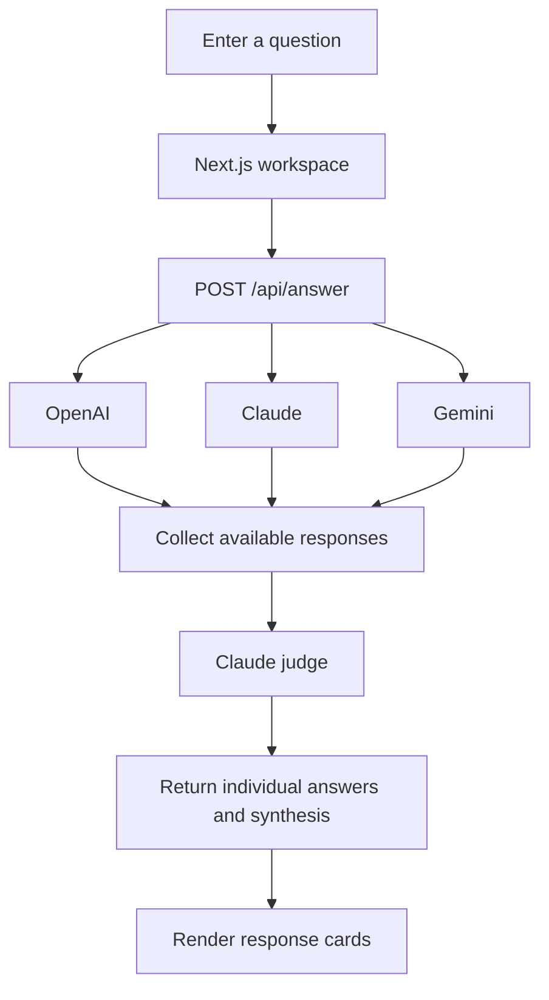

<div align="center">

# ✨ Synthora

### One question. Multiple perspectives. One clearer answer.

**Synthora** brings together answers from OpenAI, Anthropic Claude, and Google Gemini, then asks a judge model to review the responses and create one concise synthesis.

<p>
  
  
  
  
</p>

<p>
  <a href="#why-synthora">Why Synthora</a> ·
  <a href="#features">Features</a> ·
  <a href="#how-it-works">How it works</a> ·
  <a href="#getting-started">Getting started</a> ·
  <a href="#configuration">Configuration</a>
</p>

</div>

---

## Why Synthora?

A single model can give a useful answer, but it can also miss a perspective, overlook a caveat, or state something too confidently. Synthora lets you compare responses from multiple models and then uses a separate judge step to produce a unified answer.

The goal is not to treat majority agreement as proof. It is to make the different perspectives easier to inspect, surface meaningful disagreements, and provide a useful synthesis while keeping uncertainty visible.

> **Note:** The judge is another AI model, not an independent source of truth. Important or high-stakes claims should still be checked against reliable sources.

## Features

- **Three independent model responses** — Send one question to OpenAI, Claude, and Gemini.
- **Concurrent model calls** — Request all three responses in parallel.
- **Judge-based synthesis** — Give the original question and available model responses to a Claude judge for evaluation and consolidation.
- **Compare the responses** — Keep each provider's answer visible alongside the final synthesis.
- **Markdown rendering** — Display headings, lists, tables, links, and code in readable form.
- **Scrollable response cards** — Read long answers inside bounded panels instead of stretching the whole page.
- **Copy the final answer** — Copy the synthesized response from the interface.
- **Partial provider-failure handling** — Preserve successful responses when one provider request fails.
- **Latency diagnostics** — Log individual provider, judge, and overall request timings in the server terminal.
- **Responsive web interface** — A focused workspace built with Next.js, React, Tailwind CSS, and Lucide icons.

## How it works



1. **Ask** — Enter a question in the Synthora workspace.
2. **Generate** — The server sends the question to OpenAI, Claude, and Gemini concurrently.
3. **Collect** — Synthora records successful answers and reports provider failures without exposing detailed provider errors to the browser.
4. **Synthesize** — The judge reviews the available answers and prepares a consolidated response.
5. **Review** — The UI displays the individual answers and the judge's final response.

The current API responds after the model calls and judge have finished; it does not yet stream each answer into the UI as soon as it arrives.

## Tech stack

| Area                  | Technology                                                                                                            |
| --------------------- | --------------------------------------------------------------------------------------------------------------------- |
| Framework and routing | [Next.js App Router](https://nextjs.org/)                                                                             |
| UI                    | [React](https://react.dev/)                                                                                           |
| Styling               | [Tailwind CSS](https://tailwindcss.com/)                                                                              |
| Icons                 | [Lucide React](https://lucide.dev/)                                                                                   |
| Markdown              | [react-markdown](https://github.com/remarkjs/react-markdown) and [remark-gfm](https://github.com/remarkjs/remark-gfm) |
| OpenAI integration    | [`openai`](https://www.npmjs.com/package/openai) SDK                                                                  |
| Anthropic integration | [`@anthropic-ai/sdk`](https://www.npmjs.com/package/@anthropic-ai/sdk)                                                |
| Gemini integration    | [`@google/genai`](https://www.npmjs.com/package/@google/genai) SDK                                                    |
| Configuration         | `.env.local` and Node.js environment variables                                                                        |

## Getting started

### Prerequisites

- Node.js **20.9 or later**
- npm
- API keys for the model providers you want to use:
  - [OpenAI API](https://platform.openai.com/)
  - [Anthropic Console](https://console.anthropic.com/)
  - [Google AI Studio](https://aistudio.google.com/)

Each provider may charge for API usage. Check the provider's current pricing and model availability before running requests.

### 1. Clone the repository

```bash
git clone https://github.com/codzenn/Synthora.git
cd Synthora
```

### 2. Install web dependencies

The Next.js application lives in `web/`. Install its dependencies from that directory:

```bash
cd web
npm install
```

### 3. Configure environment variables

Create a file named `web/.env.local` and add your API keys and model IDs. Use model IDs currently available to your own API accounts; the names below are placeholders, not guaranteed provider model names.

```dotenv
OPENAI_API_KEY=your_openai_api_key
ANTHROPIC_API_KEY=your_anthropic_api_key
GEMINI_API_KEY=your_gemini_api_key

OPENAI_MODEL=your_supported_openai_model_id
CLAUDE_MODEL=your_supported_claude_model_id
GEMINI_MODEL=your_supported_gemini_model_id
JUDGE_MODEL=your_supported_claude_model_id
```

The application reads these model variables in its provider services. `JUDGE_MODEL` should refer to a Claude model because the judge service uses the Anthropic SDK.

**Keep these values private.** Do not commit `.env.local`, put provider keys in browser code, or prefix secret keys with `NEXT_PUBLIC_`. The repository's `.gitignore` excludes `.env` files; still verify that your local environment file is ignored before committing.

### 4. Run the development server

From the `web/` directory:

```bash
npm run dev
```

Open [http://localhost:3000](http://localhost:3000).

### 5. Check the production build

From `web/`:

```bash
npm run lint
npm run build
```

To run the built app locally after a successful build:

```bash
npm run start
```

## Configuration reference

| Variable            | Used for                                                           |
| ------------------- | ------------------------------------------------------------------ |
| `OPENAI_API_KEY`    | Authentication for OpenAI requests                                 |
| `ANTHROPIC_API_KEY` | Authentication for Claude and judge requests                       |
| `GEMINI_API_KEY`    | Authentication for Gemini requests                                 |
| `OPENAI_MODEL`      | Model used to generate the OpenAI answer                           |
| `CLAUDE_MODEL`      | Model used for the independent Claude answer                       |
| `GEMINI_MODEL`      | Model used to generate the Gemini answer                           |
| `JUDGE_MODEL`       | Claude model used to evaluate and synthesize the available answers |

Next.js loads `web/.env.local` for the web app. Environment variables are read server-side by the provider services and API route; provider keys should never be exposed in client components.

## Project structure

```text
Synthora/
├── web/
│   ├── services/
│   │   ├── openai.js          # OpenAI provider call
│   │   ├── claude.js          # Independent Claude provider call
│   │   ├── gemini.js          # Gemini provider call and timing log
│   │   └── judge.js           # Claude-based synthesis and diagnostics
│   ├── src/
│   │   └── app/
│   │       ├── api/
│   │       │   └── answer/
│   │       │       └── route.js  # Server-side POST endpoint
│   │       ├── globals.css
│   │       ├── layout.js
│   │       └── page.js           # Synthora UI
│   ├── next.config.mjs
│   ├── package.json
│   └── .env.local                # Local secrets (not committed)
├── index.js                      # Earlier terminal entry point
├── package.json                  # Root Node.js dependencies
├── package-lock.json
├── .gitignore
└── README.md
```

### About the terminal entry point

The repository also includes a root-level `index.js` for running Synthora in the terminal. It imports the same provider services from `web/services/` as the web API. To use it from a fresh checkout, install the root dependencies, configure the model environment variables in a root `.env` file, and run `node index.js`.

## Performance and troubleshooting

### Requests are slow

The three model calls run concurrently, so the slowest provider generally determines when synthesis can begin. The judge then adds its own latency. During local development, inspect the terminal running `npm run dev` for logs such as:

```text
[Synthora timing] OpenAI: ... ms
[Synthora timing] Claude: ... ms
[Synthora timing] Gemini: ... ms
[Synthora timing] Judge: ... ms
[Synthora timing] Total server processing: ... ms
```

To investigate, compare the durations across repeated requests, check provider errors and model availability, reduce unnecessary output length, or test a faster model supported by your account. The current request flow does not stream partial responses to the browser.

### A model request fails

- Check that the corresponding API key is set in `web/.env.local`.
- Verify that the configured model ID is available to your provider account.
- Restart the development server after changing environment variables.
- Inspect the server terminal for the detailed provider error; the API route intentionally returns generic provider error messages to the browser.
- Confirm that billing, account limits, and rate limits allow the request.

### The judge's response is incomplete

The judge service logs its model, output-token usage, stop reason, and answer length. Check the terminal for the `[Synthora judge]` entry. A `max_tokens` stop reason can indicate that the configured output limit was reached.

### A service import fails

The current web API imports from `web/services/`. If you move files, update the import paths in `web/src/app/api/answer/route.js` and ensure the Next.js/Turbopack root can resolve the service directory.

## Security and limitations

- Provider API calls are made from server-side code.
- Do not commit API keys or environment files.
- Treat model-generated content as unverified until checked against reliable sources.
- The judge can compare and synthesize responses, but it cannot guarantee factual accuracy or independently validate claims without external evidence.
- The project currently has no user authentication, persistence layer, request history, or built-in rate limiting. Add appropriate safeguards before exposing the API route to the public internet.
- No `LICENSE` file is currently present in the repository. Add a license if you intend to grant explicit terms for reuse or redistribution.

## Roadmap

Possible next improvements:

- [ ] Stream or progressively render responses as providers finish.
- [ ] Highlight important disagreements between model answers.
- [ ] Add timeout and retry policies for slow providers.
- [ ] Add request rate limiting and usage controls.
- [ ] Add screenshots to the README.

## Contributing

Ideas, bug reports, and focused improvements are welcome. Open an issue to discuss a change, or submit a pull request describing the problem and the proposed solution.

## License

No license file is currently included. Until a license is added, do not assume the repository grants permission to reuse or redistribute its code.

---

<div align="center">

**Synthora** · Ask once. Compare perspectives. Think more clearly.

</div>
